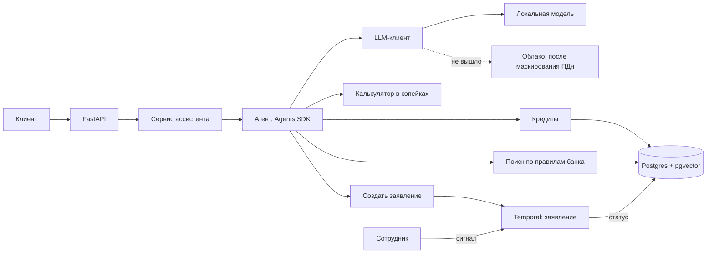

# Архитектура

Схема целевой системы со встречи 1. В коде уже есть каркас, кредиты, калькулятор и агент с
инструментами; заявления, поиск по документам и облачная модель появятся на следующих встречах.

## Где решает модель, а где код

| Решение | Кто | Почему |
| --- | --- | --- |
| Какой инструмент вызвать | модель | намерение клиента заранее неизвестно |
| Новый платеж, проценты, остаток | код | точность до копейки |
| Можно ли перенести дату | код | формальное правило регламента |
| Шаги заявления | код | порядок известен заранее |
| Формулировка ответа | модель | работа с языком |

## Где живет состояние

| | Что это | Живет | Где |
| --- | --- | --- | --- |
| Сессия | история диалога с клиентом | минуты | сессия SDK |
| Задача | статус заявления для клиента | часы | таблица `jobs` |
| Процесс | шаги заявления, решение сотрудника | дни | Temporal |

## Слои

`routers` (HTTP) → `services` (сценарии) → `domain` (калькулятор, чистые функции) и
`repositories` (только здесь SQL) → `core` (настройки, пул соединений, логи, миграции).
Импорты идут только вниз.
